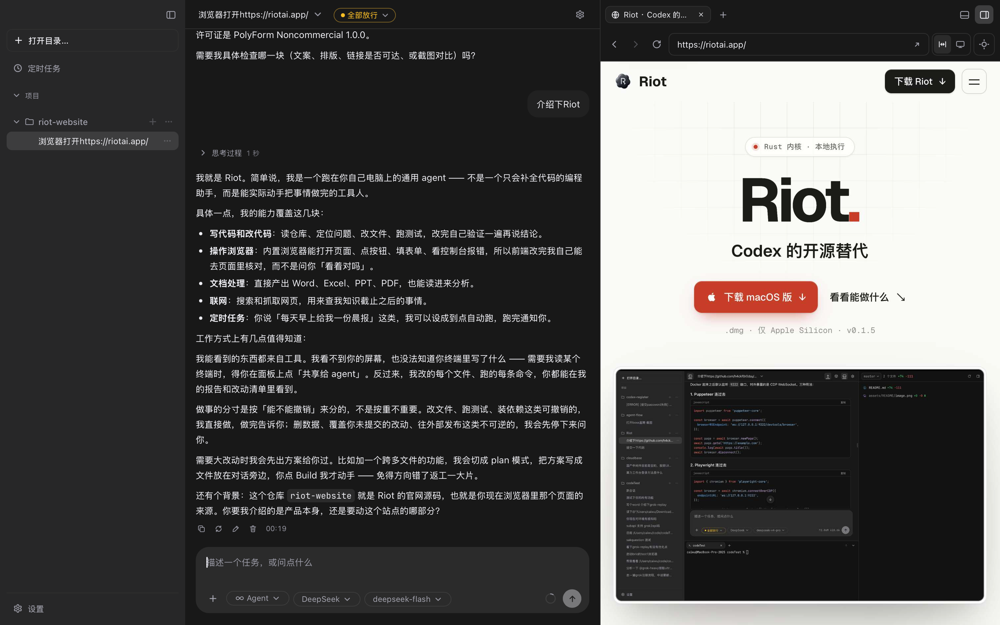

<div align="center">
  

# Riot

**An AI coding agent that works with any model and runs on your own machine.** Source-available. Rust core.

[中文](README.md) · English

[Download](https://github.com/riot-org/Riot/releases/latest) ·
[Features](#features) ·
[Server](#linux-server) ·
[Development](#development)

[](https://github.com/riot-org/Riot/releases/latest)
[](LICENSE)
[](#download)
</div>

---



## Features

**In one line: an AI coding agent that works with any model and runs on your own machine or server.** Claude, GPT, DeepSeek, GLM, Kimi and others, switchable in the same window; your code and data don't pass through any third-party relay.

### Coding

- **Code intelligence (LSP)**: Uses the rust-analyzer, typescript-language-server, or pyright already on your machine to go to definitions, find references, show types, and list symbols. New errors are attached after each edit.
- **Auto memory**: Corrections and confirmed preferences are saved per project and loaded into later sessions; review and edit them in Settings → Memory.
- **GitHub loop**: Built-in `pr`, `fix-ci`, and `address-comments` skills use `gh` to open PRs, fix failing CI from its logs, and work through review comments.
- **Multi-agent**: Search, analysis, and implementation go to background sub-agents. The main task coordinates.
- **CLI / CI**: `riot exec "task"` runs one task without a UI and exits. See [Command line](#command-line-riot-exec).

### Beyond code

- **Built-in browser**: The agent navigates, clicks, fills forms, and takes screenshots, each step shown in the browser panel. Click an element to attach its selector and structure to the chat.
- **Documents**: Create and edit Word, Excel, PowerPoint, and PDF. Formulas and layout render on the machine.
- **Schedules**: Run daily, on weekdays, weekly, or at a set time. Missed runs are caught up.
- **Security testing**: Built-in crawl, fuzz, and secret-leak scans with an evidence-backed report. Only for targets you're authorized to test.

### Deployment

- **Remote access**: Open a running Riot from a phone or another computer's browser. The task stays on the original machine.
- **Server deploy**: Run it on a Linux server. Close the laptop and the task keeps going.

### Safety

- **Command sandbox**: On by default on macOS and Linux; commands the agent runs can only write to the project. On Windows, install it once in Settings → Permissions. The default permission mode follows the sandbox: allow-all where the sandbox is on, Auto on Windows (clearly safe actions run, the rest ask).
- **Project trust**: A project's own `.riot/hooks.json`, skills, and commands load only after you click "Trust this project". Hooks run commands directly on your computer, so a cloned repository can't use them to run code.
- Settings → General → Environment shows at a glance whether the sandbox, git, gh, and language servers work, and how to install what's missing.

## Download

| System | Package |
| --- | --- |
| macOS (Apple Silicon) | [`Riot_*_aarch64.dmg`](https://github.com/riot-org/Riot/releases/latest), drag into Applications |
| Windows 10 / 11 (x64) | [`Riot_*_x64-setup.exe`](https://github.com/riot-org/Riot/releases/latest), run the installer |
| Linux server (x86_64 / arm64) | `docker pull ghcr.io/riot-org/riot-server:latest`, see [Server](#linux-server) |

After install, add a model API key in Settings.

The macOS build is unsigned. If the first launch is blocked, right-click the app in Finder and choose Open, or:

```bash
xattr -dr com.apple.quarantine /Applications/Riot.app
```

## Linux server

Headless `riot-server` runs on a server. Open it in a browser; the UI matches the desktop app. The image supports x86_64 and arm64.

**1. Start the container**

```bash
docker run -d --name riot --restart unless-stopped \
  -p 127.0.0.1:7823:7823 \
  -v riot-home:/home/riot \
  --security-opt seccomp=unconfined --security-opt apparmor=unconfined \
  ghcr.io/riot-org/riot-server:latest
```

| Flag | What it does |
| --- | --- |
| `-p 127.0.0.1:7823:7823` | Bind to loopback only. The web UI has no TLS; do not expose it on the public internet |
| `-v riot-home:/home/riot` | Config, API keys, sessions, and project files live here. They survive upgrades and container rebuilds |
| `--security-opt …=unconfined` | Lets the command sandbox (bubblewrap) create a user namespace. The server still runs without it, but commands the agent runs are not isolated |
| `--restart unless-stopped` | Start again after the host reboots |

**2. Get the login URL**

```bash
docker exec riot riot-server token --listen 127.0.0.1:7823
```

The output looks like `http://127.0.0.1:7823/#token=…`. The token is created on first run and printed unchanged after that. Open it in a browser and add a model API key in Settings. If the token leaks, pass `--rotate` to issue a new one: the old link stops working immediately, and pages already open fail after they reconnect.

**3. Reach it from another machine**

The port listens only on the server itself. Use a tunnel or a reverse proxy:

- **SSH tunnel** (simplest): on your computer run `ssh -N -L 7823:127.0.0.1:7823 user@server`, then open the login URL above.
- **Reverse proxy** (nginx, Caddy, Tailscale Serve, and similar, with HTTPS): proxy to `127.0.0.1:7823` and forward WebSockets. When starting the container, add `-e RIOT_REMOTE_ALLOWED_ORIGINS=https://riot.example.com`, or the WebSocket handshake is rejected because the origin does not match. In the login URL, replace `http://127.0.0.1:7823` with your domain.

**Environment variables**

| Variable | Default | What it does |
| --- | --- | --- |
| `RIOT_LISTEN` | `0.0.0.0:7823` inside the container | Listen address, same as `--listen` |
| `RIOT_REMOTE_ALLOWED_ORIGINS` | empty | External addresses of the reverse proxy, comma-separated |
| `RIOT_LOG` | `info` | Log level, such as `debug` or `riot=debug`. Read with `docker logs riot` |
| `RIOT_WEB_DIR` | bundled in the image | Web frontend directory, same as `--web-dir`. Only needed when you replace the frontend |

**Upgrade**

```bash
docker pull ghcr.io/riot-org/riot-server:latest
docker rm -f riot
```

Start it again with the command in step 1. Data stays in the `riot-home` volume, and the login link stays the same.

The image only has basic command-line tools. If the agent needs Node, Python, or a compiler, write another image `FROM` this one and install them. Building your own image, a systemd deploy without Docker, and how it works are in [REMOTE_ACCESS.md](docs/REMOTE_ACCESS.md#9-无界面宿主riot-server).

## Command line (`riot exec`)

Run one task without a UI and exit. Same kernel and model settings as the app.

- Desktop: click Install for the command line tool in Settings → General → Environment, then use `riot exec` in a terminal. It's a small console program that hands the task to the app, so terminals wait for it and exit codes, pipes, and Ctrl-C behave like any command (Windows included).
- Server / Docker: `riot-server exec`, with the same options.

```bash
riot exec "fix issue #42 and run the tests"
git diff | riot exec --mode plan "review this change; only point out bugs"
riot exec --json "..." > events.jsonl
```

- Default mode is `auto`: clearly safe actions run; anything that still needs a person is denied, the agent is told nobody is there, and the denied actions are listed on stderr. Use `--mode bypass` to allow them.
- A project's own hooks, skills, and commands aren't loaded until the project is trusted; `--trust` trusts it for this run only.
- stdout has only the final answer (one event per line with `--json`); progress goes to stderr.
- Exit codes: 0 done, 1 error, 2 bad arguments, 3 stopped to ask the user, 124 timed out, 130 interrupted.
- Sessions are kept in `exec-sessions/` under the config directory, apart from the app's sessions.

**In CI**, where there's no configured app, define the provider with flags. Nothing is written to disk; the key comes from an environment variable:

```bash
riot-server exec --protocol anthropic --model claude-sonnet-5-5 \
  --api-key-env ANTHROPIC_API_KEY --trust --mode bypass "fix the failing tests"
```

`--protocol` is `anthropic` or `openai` (for OpenAI-compatible services such as DeepSeek, add `--base-url https://api.deepseek.com`). In GitHub Actions you can run it in the `ghcr.io/riot-org/riot-server` image.

## Development

Requires Rust 1.88+, Node.js 22, and pnpm 10.

```bash
git clone https://github.com/riot-org/Riot.git
cd Riot
pnpm install
pnpm tauri dev
```

Tests, packaging, and releases are in [DEVELOPMENT.md](docs/DEVELOPMENT.md). Architecture is in [ARCHITECTURE.md](docs/ARCHITECTURE.md).

Evaluation: `python3 evals/run.py` runs the tasks in `evals/tasks/` through `riot exec`, grades them with hidden acceptance tests, and reports pass rate, time, and tokens (`-- --model xxx` to compare models). See [evals/run.py](evals/run.py).

## License

[PolyForm Noncommercial 1.0.0](LICENSE): source-available, free for personal and noncommercial use; commercial use needs a separate license. It is not an OSI-approved open-source license.
