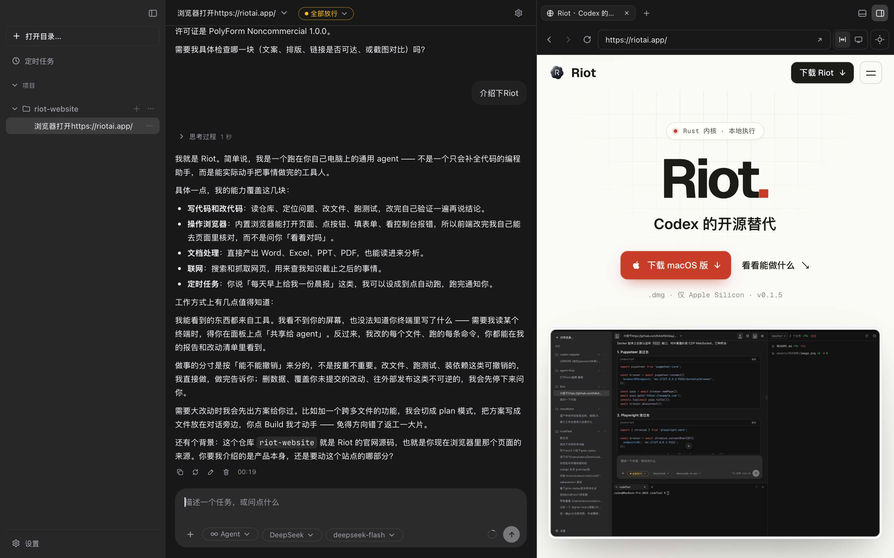

<div align="center">
  

# Riot

**Codex 的开源替代。** Rust 内核，本地执行。

[下载](https://github.com/riot-org/Riot/releases/latest) ·
[功能](#功能) ·
[服务器部署](#linux-服务器部署) ·
[开发](#开发)

[](https://github.com/riot-org/Riot/releases/latest)
[](LICENSE)
[](#下载)
</div>

---



## 功能

不只写代码。网页、文档、定时任务也能做。

- **远程连接**：用手机或另一台电脑的浏览器连上正在运行的 Riot，任务还在原来那台机器上跑。
- **多 Agent 协作**：检索、分析、实现分给后台子 Agent，主任务负责协调。
- **定时任务**：每天、工作日、每周或指定时间自动跑，错过的运行会补上。
- **文档能力**：直接生成和修改 Word、Excel、PPT、PDF，公式计算和排版渲染都在本机完成。
- **内置浏览器**：Agent 导航、点击、填表、截图，每一步都显示在浏览器面板上。
- **DOM 拾取**：点一下页面元素，选择器和结构就附进对话。
- **服务器部署**：部署到 Linux 服务器，电脑合上了任务照样跑。
- **安全渗透**：内置爬取、Fuzz、密钥泄露扫描，结果整理成带证据和修复建议的报告。

## 下载

| 系统                           | 安装包                                                                                     |
| ------------------------------ | ------------------------------------------------------------------------------------------ |
| macOS（Apple Silicon）         | [`Riot_*_aarch64.dmg`](https://github.com/riot-org/Riot/releases/latest)，拖进「应用程序」 |
| Windows 10 / 11（x64）         | [`Riot_*_x64-setup.exe`](https://github.com/riot-org/Riot/releases/latest)，运行安装程序   |
| Linux 服务器（x86_64 / arm64） | `docker pull ghcr.io/riot-org/riot-server:latest`，见[服务器部署](#linux-服务器部署)     |

装好后在设置里填上模型 API Key 就能用。

macOS 包未签名，首次打开被拦时用访达右键 → 打开，或：

```bash
xattr -dr com.apple.quarantine /Applications/Riot.app
```

## Linux 服务器部署

无界面版 `riot-server` 跑在服务器上，用浏览器访问，界面和桌面版一样。镜像支持 x86_64 和 arm64。

**1. 启动容器**

```bash
docker run -d --name riot --restart unless-stopped \
  -p 127.0.0.1:7823:7823 \
  -v riot-home:/home/riot \
  --security-opt seccomp=unconfined --security-opt apparmor=unconfined \
  ghcr.io/riot-org/riot-server:latest
```

| 参数 | 说明 |
| --- | --- |
| `-p 127.0.0.1:7823:7823` | 只映射到本机回环。网页版不带 TLS，别直接暴露到公网 |
| `-v riot-home:/home/riot` | 配置、API Key、会话和项目文件都在这里，升级、重建容器不丢 |
| `--security-opt …=unconfined` | 给命令沙箱（bubblewrap）建 user namespace 用。不加也能跑，但 agent 执行的命令不隔离 |
| `--restart unless-stopped` | 服务器重启后自动拉起 |

**2. 拿登录地址**

```bash
docker exec riot riot-server token --listen 127.0.0.1:7823
```

输出形如 `http://127.0.0.1:7823/#token=…`，令牌只在第一次运行时生成，之后每次打印的都是同一个。浏览器打开后，在设置里填模型 API Key 就能用。令牌泄露了就加 `--rotate` 换一枚：旧链接马上不能再登录，已经打开的页面断线重连后也会失效。

**3. 从别的机器访问**

端口只听服务器本机，外面要经隧道或反向代理进来：

- **SSH 隧道**（最省事）：在自己电脑上运行 `ssh -N -L 7823:127.0.0.1:7823 user@服务器`，然后打开上面的登录地址。
- **反向代理**（nginx / Caddy / Tailscale Serve 等，带 HTTPS）：代理到 `127.0.0.1:7823`，并开启 WebSocket 转发。启动容器时加上 `-e RIOT_REMOTE_ALLOWED_ORIGINS=https://riot.example.com`，否则 WebSocket 握手会因为来源不匹配被拒。登录地址把 `http://127.0.0.1:7823` 换成你的域名。

**环境变量**

| 变量 | 默认 | 说明 |
| --- | --- | --- |
| `RIOT_LISTEN` | 容器内 `0.0.0.0:7823` | 监听地址，等同 `--listen` |
| `RIOT_REMOTE_ALLOWED_ORIGINS` | 空 | 反向代理的外部地址，多个用逗号分隔 |
| `RIOT_LOG` | `info` | 日志级别，如 `debug`、`riot=debug`。用 `docker logs riot` 查看 |
| `RIOT_WEB_DIR` | 镜像自带 | 网页前端目录，等同 `--web-dir`，自己改前端时才用 |

**升级**

```bash
docker pull ghcr.io/riot-org/riot-server:latest
docker rm -f riot
```

然后用第 1 步的命令重新启动。数据在 `riot-home` 卷里，登录链接不变。

镜像里只有基本命令行工具。agent 要用 node、python、编译器这类运行时，就基于这个镜像再写一层 `FROM` 装上。自己构建镜像、不用 Docker 的 systemd 部署，以及原理说明，见 [REMOTE_ACCESS.md](docs/REMOTE_ACCESS.md#9-无界面宿主riot-server)。

## 开发

需要 Rust 1.88+、Node.js 22、pnpm 10。

```bash
git clone https://github.com/riot-org/Riot.git
cd Riot
pnpm install
pnpm tauri dev
```

测试、打包和发版见 [DEVELOPMENT.md](docs/DEVELOPMENT.md)，架构见 [ARCHITECTURE.md](docs/ARCHITECTURE.md)。

## 许可

[PolyForm Noncommercial 1.0.0](LICENSE)：个人与非营利用途免费，商业使用需另行授权。
